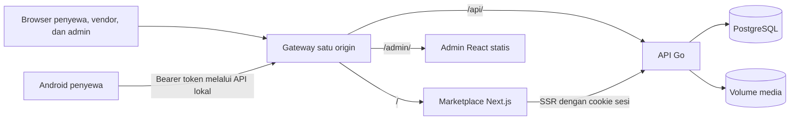

# Rentaid

Marketplace penyewaan barang dengan aplikasi web untuk penyewa dan vendor, panel admin/CMS, serta aplikasi Android untuk penyewa. Demo lokal mendukung alur pilih produk → checkout → bayar simulasi → serah terima → pengembalian, dengan data tersimpan di PostgreSQL.

Pembayaran dan refund adalah simulasi lokal tanpa perpindahan uang. Runtime demo tidak memerlukan layanan pihak ketiga; build pertama memerlukan unduhan dependensi dan image.

## Daftar isi

- [Tentang](#tentang)
- [Fitur](#fitur)
- [Teknologi](#teknologi)
- [Arsitektur](#arsitektur)
- [Struktur proyek](#struktur-proyek)
- [Mulai cepat](#mulai-cepat)
- [Konfigurasi](#konfigurasi)
- [Keamanan](#keamanan)
- [Kontribusi](#kontribusi)
- [Status dan arah pengembangan](#status-dan-arah-pengembangan)
- [Lisensi](#lisensi)
- [Apresiasi](#apresiasi)
- [Pengelola](#pengelola)

## Tentang

Rentaid mempertemukan penyewa dengan toko rental yang disetujui admin. Satu akun pengguna dapat menyewa sekaligus memiliki satu toko; pengelolaan vendor tersedia melalui web. Admin memakai panel terpisah untuk mengelola pengguna, toko, katalog, transaksi, dan konten.

MVP ditujukan untuk demo lokal dan APK Android yang dapat dipasang. Antarmuka menggunakan Bahasa Indonesia, rupiah, dan zona waktu Asia/Jakarta. Hosting publik, pembayaran sungguhan, dan publikasi Play Store berada di luar cakupan MVP.

## Fitur

| Area          | Kemampuan                                                                                                                             |
| ------------- | ------------------------------------------------------------------------------------------------------------------------------------- |
| Akun          | Pendaftaran, login, profil, logout, dan pencabutan sesi saat pengguna ditangguhkan.                                                   |
| Katalog       | Pencarian, kategori, pagination, detail produk, foto, dan informasi toko.                                                             |
| Vendor        | Pengajuan toko, pengajuan ulang setelah penolakan, serta pengelolaan produk, foto, stok, publikasi, dan arsip.                        |
| Penyewaan     | Satu produk per pesanan, penawaran harga harian inklusif, ketersediaan per tanggal, dan hold stok 15 menit.                           |
| Transaksi     | Pembayaran simulasi berhasil/gagal/kedaluwarsa, pembatalan sebelum serah terima, dan refund simulasi penuh setelah pembayaran sukses. |
| Pesanan       | Serah terima dan pengembalian oleh vendor, riwayat status, pembayaran, serta refund sesuai hak akses.                                 |
| Admin dan CMS | Persetujuan toko, moderasi produk, kategori, pengguna, pesanan, serta draft/publikasi beranda, FAQ, tentang, syarat, dan privasi.     |
| Android       | Alur penyewa, token terlindungi Keystore, serta pemulihan upaya checkout dan pembayaran setelah koneksi terputus.                     |
| Operasional   | Seed berulang, health check, volume persisten, serta backup/restore database dan media.                                               |

## Teknologi

| Komponen    | Teknologi dan versi                                                                         |
| ----------- | ------------------------------------------------------------------------------------------- |
| Workspace   | Node.js 24.22.1, pnpm 12.14.0, TypeScript 5.9.3                                             |
| Marketplace | Next.js 16.4.3, React 19.3.1                                                                |
| Admin/CMS   | React 19.3.1, Vite 8.3.5                                                                    |
| API         | Go 1.27.2, `net/http`, pgx, kin-openapi, migrasi SQL berversi                               |
| Database    | PostgreSQL 18.1 melalui Docker Compose                                                      |
| Android     | Kotlin 2.1.20, Jetpack Compose, JDK 17, Android SDK 35, Gradle Wrapper 8.11.1               |
| Kontrak     | OpenAPI 3.0.3, openapi-typescript, openapi-fetch, OpenAPI Generator untuk Kotlin            |
| Kualitas    | ESLint, Prettier, Go vet, golangci-lint, ktlint, Playwright, dan test instrumentasi Android |

Versi mengikuti manifest aplikasi, lockfile, Gradle, dan konfigurasi Compose di repository.

## Arsitektur



Diagram menunjukkan demo Compose. Saat pengembangan, Next.js dan Vite meneruskan `/api` ke Go. API Go menjadi satu-satunya aplikasi yang mengakses database dan menjalankan aturan bisnis. Kontrak REST `/api/v1` menghasilkan klien TypeScript dan Kotlin; media disajikan melalui API.

## Struktur proyek

```text
apps/
  web/          Marketplace penyewa dan vendor
  admin/        Panel admin dan CMS
  api/          API Go, migrasi, dan seed
  android/      Aplikasi Kotlin dan klien hasil generate
packages/
  contracts/    Spesifikasi OpenAPI dan konfigurasi generator
  api-client/   Klien TypeScript dan tipe hasil generate
  ui/           Token dan gaya bersama aplikasi web
infra/          Docker Compose dan reverse proxy
scripts/        Perintah pengembangan, build, demo, dan test
tests/          Pengujian lintas aplikasi dan fixture
docs/           Panduan operasional dan keputusan teknis
```

Folder proyek lama dipertahankan sebagai referensi dan tidak termasuk workspace, build, atau runtime baru.

## Mulai cepat

Siapkan **Node.js 24.22.1**, **pnpm 12.14.0**, dan **Docker dengan Compose aktif**, lalu buka terminal di root repository. Go host tidak diperlukan untuk demo Compose. Contoh PowerShell ini memakai project dan port database terpisah dari pengembangan default:

```powershell
pnpm install --frozen-lockfile
$env:RENTAID_COMPOSE_PROJECT = "rentaid-demo"
$env:RENTAID_DB_PORT = "5433"
$env:RENTAID_HTTP_PORT = "8081"
$env:SEED_ADMIN_EMAIL = "admin@example.test"
foreach ($taskVariable in @("SEED_ADMIN_PASSWORD", "SEED_DEMO_PASSWORD")) {
  $taskSecret = Read-Host "$taskVariable (minimal 12 karakter)" -AsSecureString
  $taskPtr = [Runtime.InteropServices.Marshal]::SecureStringToBSTR($taskSecret)
  try { Set-Item -Path "Env:$taskVariable" -Value ([Runtime.InteropServices.Marshal]::PtrToStringBSTR($taskPtr)) }
  finally { [Runtime.InteropServices.Marshal]::ZeroFreeBSTR($taskPtr) }
}
pnpm demo:up
Remove-Item Env:SEED_ADMIN_PASSWORD, Env:SEED_DEMO_PASSWORD
```

`demo:up` membangun aplikasi, menjalankan migrasi, menunggu health check, dan membuat data demo. Pilih port yang tersedia dan pertahankan variabel project/port pada terminal untuk perintah berikutnya.

| Layanan                   | Alamat                                |
| ------------------------- | ------------------------------------- |
| Marketplace               | <http://127.0.0.1:8081/>              |
| Admin                     | <http://127.0.0.1:8081/admin/>        |
| Kesiapan API dan database | <http://127.0.0.1:8081/api/v1/ready>  |
| Liveness proses API       | <http://127.0.0.1:8081/api/v1/health> |

Masuk ke admin dengan email dan password seed yang Anda tentukan. Vendor contoh adalah `demo.approved@example.test` dengan password `SEED_DEMO_PASSWORD`; daftarkan akun penyewa dari marketplace. Seed berulang tidak mengganti password akun yang sudah ada.

Hentikan dengan `pnpm demo:down`; volume database dan media tetap tersimpan. Untuk memulai kembali, tetapkan lagi password seed yang sama dan jalankan `pnpm demo:up` dengan project yang sama.

Lanjutkan ke [indeks dokumentasi](docs/README.md), [panduan demo web dan backup/restore](docs/engineering/demo.md), [build dan pemasangan APK Android](docs/users/android.md), atau [pengembangan lokal](docs/engineering/development.md).

## Konfigurasi

[`.env.example`](.env.example) adalah referensi dan **tidak dimuat otomatis** oleh perintah pnpm. Tetapkan variabel yang diperlukan di environment terminal.

| Variabel                                   | Kegunaan dan nilai lokal                                                                                                              |
| ------------------------------------------ | ------------------------------------------------------------------------------------------------------------------------------------- |
| `RENTAID_COMPOSE_PROJECT`                  | Nama project demo; default `rentaid`, contoh mulai cepat `rentaid-demo`.                                                              |
| `RENTAID_DB_PORT` / `RENTAID_HTTP_PORT`    | Port host PostgreSQL / gateway; default `5432` / `8081`.                                                                              |
| `SEED_ADMIN_EMAIL` / `SEED_ADMIN_PASSWORD` | Akun admin awal; wajib untuk seed, password minimal 12 karakter.                                                                      |
| `SEED_DEMO_PASSWORD`                       | Password akun demo, minimal 12 karakter; wajib pada `demo:up` dan `demo:seed`.                                                        |
| `APP_ENV` / `DATABASE_URL`                 | Lingkungan dan koneksi API host; contoh `local` dan URL PostgreSQL pada `.env.example`. Compose mengatur koneksi internalnya sendiri. |
| `PAYMENT_SIMULATOR_ENABLED`                | Aktif dengan nilai `true`; contoh environment dan Compose lokal mengaktifkannya.                                                      |
| `API_ORIGIN`                               | Alamat API untuk server Next.js; default pengembangan `http://127.0.0.1:8080`.                                                        |

Konfigurasi sesi, Origin, media, serta koneksi Android tersedia di [panduan pengembangan](docs/engineering/development.md#konfigurasi).

## Keamanan

- Password di-hash dengan Argon2id; sesi disimpan di database dengan hash token SHA-256 dan masa berlaku default 14 hari.
- Browser memakai cookie `HttpOnly`, `SameSite=Lax`, dan `Secure` di luar lokal; permintaan perubahan memerlukan CSRF dan pemeriksaan Origin.
- Admin hanya memakai panel admin. Otorisasi penyewa, pemilik toko, dan admin dijalankan di API Go.
- Android menyimpan token secara terenkripsi menggunakan Keystore. HTTP lokal hanya diizinkan pada build debug.
- Unggahan JPEG, PNG, dan WebP diverifikasi berdasarkan isi, dibatasi 5 MB, dan disimpan dengan nama acak.
- Seed menolak lingkungan production. Gunakan konfigurasi contoh lokal dan simpan password, token, serta backup secara privat.

Aturan lengkap tersedia di [panduan proyek](AGENTS.md#keamanan-sesi-dan-media).

## Kontribusi

Baca [panduan proyek](AGENTS.md), [keputusan teknis](docs/architecture/decisions.md), dan [panduan pengembangan](docs/engineering/development.md). Gunakan bahasa Inggris untuk kode, identifier, komentar kode, dan pesan commit; gunakan Bahasa Indonesia untuk UI dan panduan pengguna. Ikuti Conventional Commits dan branch per phase yang dibuat pengguna.

| Perintah                                      | Tujuan                                                                      |
| --------------------------------------------- | --------------------------------------------------------------------------- |
| `pnpm check`                                  | Pemeriksaan merek, kontrak, Android, TypeScript, lint, format, dan test Go. |
| `pnpm test:unit`                              | Unit test Go, web, dan Android.                                             |
| `pnpm test:integration`                       | Integrasi PostgreSQL dan Android pada lingkungan test terpisah.             |
| `pnpm test:e2e:web` / `pnpm test:e2e:android` | E2E web/admin/API atau Android; `pnpm test:e2e` menjalankan keduanya.       |
| `pnpm api:build`                              | Build executable API ke `.artifacts/`.                                      |
| `pnpm web:build` / `pnpm admin:build`         | Build aplikasi web dan admin.                                               |
| `pnpm android:check` / `pnpm android:demo`    | Pemeriksaan/build Android atau APK demo USB dan emulator.                   |

Perubahan API harus memperbarui OpenAPI, klien terdampak, dan test kontrak. Ikuti [panduan pengujian](docs/engineering/testing.md) untuk database terpisah, E2E browser, fixture perangkat, dan test lintas aplikasi.

## Status dan arah pengembangan

Phase 01–25 serta Gate A, B, dan akhir telah selesai menurut [catatan progres](docs/archive/migration-progress.md#progres). Panduan [demo Android](docs/users/android.md#hasil-verifikasi-6-november-2026) dan [stabilitas lintas aplikasi](docs/engineering/stability.md) memuat hasil verifikasi yang telah dicatat.

[Rencana pengembangan](docs/archive/migration-plan.md) menyimpan urutan implementasi MVP. Pembayaran sungguhan, deposit, dompet, chat, ulasan, kurir, iOS, hosting publik, dan publikasi store masih di luar cakupan; pengembangan berikutnya memerlukan arahan tersendiri.

## Lisensi

Repository ini belum menyediakan berkas lisensi. Lisensi penggunaan dan distribusi belum dinyatakan; hubungi pengelola untuk kejelasan izin.

## Apresiasi

Rentaid dibangun menggunakan ekosistem Next.js, React, Go, PostgreSQL, Kotlin, Jetpack Compose, OpenAPI, dan perangkat pengujian sumber terbuka. Struktur README mengacu pada [15 Essential Sections Every README Needs](https://dev.to/georgekobaidze/15-essential-sections-every-readme-needs-give-your-project-what-it-deserves-fie) oleh Giorgi Kobaidze.

## Pengelola

Repository dikelola melalui akun GitHub [@muhroyhan](https://github.com/muhroyhan): [muhroyhan/rentaid](https://github.com/muhroyhan/rentaid).
