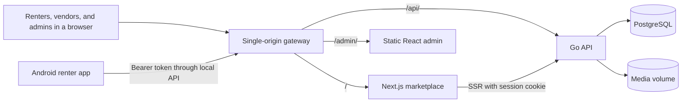

# Rentaid

A rental marketplace with a web app for renters and vendors, an admin/CMS panel, and an Android app for renters. The local demo supports the full flow: choose a product → checkout → simulated payment → handover → return, with data stored in PostgreSQL.

Payments and refunds are local simulations; no money changes hands. The demo runtime does not require third-party services. The first build downloads dependencies and container images.

## Table of contents

- [About](#about)
- [Features](#features)
- [Technology](#technology)
- [Architecture](#architecture)
- [Project structure](#project-structure)
- [Quick start](#quick-start)
- [Configuration](#configuration)
- [Security](#security)
- [Contributing](#contributing)
- [Status and roadmap](#status-and-roadmap)
- [License](#license)
- [Acknowledgments](#acknowledgments)
- [Maintainer](#maintainer)

## About

Rentaid connects renters with rental shops approved by an administrator. A user account can both rent items and own one shop; vendors manage their shops on the web. Administrators use a separate panel to manage users, shops, catalogs, transactions, and content.

The MVP is intended for local demos and an installable Android APK. The interface uses Indonesian, Indonesian rupiah, and the Asia/Jakarta time zone. Public hosting, real payments, and Play Store publication are outside the MVP scope.

## Features

| Area          | Capabilities                                                                                                                                 |
| ------------- | -------------------------------------------------------------------------------------------------------------------------------------------- |
| Accounts      | Registration, login, profile, logout, and session revocation when a user is suspended.                                                       |
| Catalog       | Search, categories, pagination, product details, photos, and shop information.                                                               |
| Vendors       | Shop applications and resubmission after rejection; product, photo, inventory, publishing, and archive management.                           |
| Rentals       | One product per order, inclusive daily pricing, date-based availability, and a 15-minute inventory hold.                                     |
| Transactions  | Simulated successful, failed, or expired payments; cancellation before handover; and full simulated refunds after successful payments.       |
| Orders        | Vendor handover and returns, status history, payments, and refunds according to access permissions.                                          |
| Admin and CMS | Shop approvals, product moderation, categories, users, orders, and draft/publish workflows for home, FAQ, about, terms, and privacy content. |
| Android       | Renter flows, Keystore-protected tokens, and recovery of checkout/payment attempts after connection loss.                                    |
| Operations    | Repeatable seeding, health checks, persistent volumes, and database/media backup and restore.                                                |

## Technology

| Component   | Technology and version                                                                         |
| ----------- | ---------------------------------------------------------------------------------------------- |
| Workspace   | Node.js 24.22.1, pnpm 12.14.0, TypeScript 5.9.3                                                |
| Marketplace | Next.js 16.4.3, React 19.3.1                                                                   |
| Admin/CMS   | React 19.3.1, Vite 8.3.5                                                                       |
| API         | Go 1.27.2, `net/http`, pgx, kin-openapi, versioned SQL migrations                              |
| Database    | PostgreSQL 18.1 through Docker Compose                                                         |
| Android     | Kotlin 2.1.20, Jetpack Compose, JDK 17, Android SDK 35, Gradle Wrapper 8.11.1                  |
| Contracts   | OpenAPI 3.0.3, openapi-typescript, openapi-fetch, OpenAPI Generator for Kotlin                 |
| Quality     | ESLint, Prettier, Go vet, golangci-lint, ktlint, Playwright, and Android instrumentation tests |

Versions are based on the application manifests, lockfile, Gradle configuration, and Compose configuration in this repository.

## Architecture



The diagram shows the Compose demo. During development, Next.js and Vite proxy `/api` requests to Go. The Go API is the only application that accesses the database and owns business rules. The REST `/api/v1` contract generates TypeScript and Kotlin clients; media is served through the API.

## Project structure

```text
apps/
  web/          Renter and vendor marketplace
  admin/        Admin and CMS panel
  api/          Go API, migrations, and seed
  android/      Kotlin app and generated client
packages/
  contracts/    OpenAPI specification and generator configuration
  api-client/   Generated TypeScript client and types
  ui/           Shared web tokens and styles
infra/          Docker Compose and reverse proxy
scripts/        Development, build, demo, and test utilities
tests/          Cross-application tests and fixtures
docs/           Operational guides and technical decisions
```

Legacy project folders are retained for reference and are excluded from the workspace, builds, and new runtime.

## Quick start

For source development, run PostgreSQL in Docker and the applications locally. Install **Node.js 24.22.1**, **pnpm 12.14.0**, **Go 1.27.2**, and **Docker Compose**. Create a local `.env` file from `.env.example` using an editor, then set `SEED_ADMIN_EMAIL` and `SEED_ADMIN_PASSWORD` (at least 12 characters). `.env` is ignored by Git and loaded automatically by the API, migration, and seed development scripts.

In the first terminal, run these scripts from the repository root:

```powershell
pnpm install --frozen-lockfile
pnpm db:up
pnpm db:migrate
pnpm db:seed
pnpm api:dev
```

Leave the API running. Open two more terminals at the repository root and start the frontend apps:

```powershell
# Second terminal: marketplace
pnpm web:dev
```

```powershell
# Third terminal: admin panel
pnpm admin:dev
```

Open the marketplace at <http://127.0.0.1:3000/> and the admin panel at <http://127.0.0.1:5173/admin/>. Check API and database readiness at <http://127.0.0.1:8080/api/v1/ready>. Sign in to the admin panel with the seeded email and password. Demo shops and products are optional; see the [demo guide](docs/engineering/demo.md).

JDK 17 and the Android SDK are only needed to develop or build the Android app; see the [Android guide](docs/users/android.md). Press Ctrl+C in each application terminal to stop it, then run `pnpm db:down` to stop PostgreSQL without deleting its volume. For environment details and other development workflows, see the [local development guide](docs/engineering/development.md). To run all apps through Compose, see the [demo guide](docs/engineering/demo.md). Browse the [documentation index](docs/README.md) for other guides.

## Configuration

Copy the contents of [`.env.example`](.env.example) to a local `.env` file using an editor. `.env` is ignored by Git and loaded automatically by the API, migration, and seed scripts; other scripts use their defaults or Compose configuration.

| Variable                                   | Purpose and local value                                                                                                                  |
| ------------------------------------------ | ---------------------------------------------------------------------------------------------------------------------------------------- |
| `RENTAID_COMPOSE_PROJECT`                  | Demo project name; defaults to `rentaid`, with `rentaid-demo` as an example.                                                             |
| `RENTAID_DB_PORT` / `RENTAID_HTTP_PORT`    | Host ports for PostgreSQL and the gateway; default to `5432` / `8081`.                                                                   |
| `SEED_ADMIN_EMAIL` / `SEED_ADMIN_PASSWORD` | Initial admin account; required for seeding, with a password of at least 12 characters.                                                  |
| `SEED_DEMO_PASSWORD`                       | Demo account password, at least 12 characters; required by `demo:up` and `demo:seed`.                                                    |
| `APP_ENV` / `DATABASE_URL`                 | API environment and host database connection; examples are `local` and the URL in `.env.example`. Compose configures its own connection. |
| `PAYMENT_SIMULATOR_ENABLED`                | Enable with `true`; enabled in the example environment and local Compose configuration.                                                  |
| `API_ORIGIN`                               | API address for the Next.js server; defaults to `http://127.0.0.1:8080` in development.                                                  |

Session, Origin, media, and Android connection settings are described in the [development guide](docs/engineering/development.md#konfigurasi).

## Security

- Passwords are hashed with Argon2id. Sessions are stored in the database as SHA-256 token hashes and expire after 14 days by default.
- Browsers use `HttpOnly`, `SameSite=Lax`, and `Secure` cookies outside local development; state-changing requests require CSRF protection and Origin checks.
- Admins use the separate admin panel. The Go API enforces renter, shop-owner, and admin permissions.
- Android stores tokens encrypted with Keystore. Local HTTP is allowed only in debug builds.
- JPEG, PNG, and WebP uploads are validated by content, limited to 5 MB, and stored under randomized names.
- Seeding is disabled in production. Use local example configuration and keep passwords, tokens, and backups private.

See the [project instructions](AGENTS.md#keamanan-sesi-dan-media) for the complete rules.

## Contributing

Read the [project instructions](AGENTS.md), [technical decisions](docs/architecture/decisions.md), and [development guide](docs/engineering/development.md). Use English for code, identifiers, code comments, and commit messages. Follow Conventional Commits and create a branch for each phase as directed by the repository maintainer.

| Command                                       | Purpose                                                                           |
| --------------------------------------------- | --------------------------------------------------------------------------------- |
| `pnpm check`                                  | Brand guard, contract, Android, TypeScript, lint, formatting, and Go test checks. |
| `pnpm test:unit`                              | Go, web, and Android unit tests.                                                  |
| `pnpm test:integration`                       | PostgreSQL and Android integration tests in an isolated test environment.         |
| `pnpm test:e2e:web` / `pnpm test:e2e:android` | Web/admin/API or Android E2E; `pnpm test:e2e` runs both.                          |
| `pnpm api:build`                              | Build the API executable in `.artifacts/`.                                        |
| `pnpm web:build` / `pnpm admin:build`         | Build the marketplace and admin applications.                                     |
| `pnpm android:check` / `pnpm android:demo`    | Check/build Android or create USB/emulator demo APKs.                             |

API changes must update OpenAPI, affected clients, and contract tests. See the [testing guide](docs/engineering/testing.md) for separate databases, browser E2E, device fixtures, and cross-application tests.

## Status and roadmap

Phases 01–25 and Gates A, B, and Final are marked complete in the [progress record](docs/archive/migration-progress.md#progres). The [Android demo guide](docs/users/android.md#hasil-verifikasi-6-november-2026) and [cross-application stability guide](docs/engineering/stability.md) contain the recorded verification results.

The [development plan](docs/archive/migration-plan.md) records the MVP implementation sequence. Real payments, deposits, wallets, chat, reviews, delivery, iOS, public hosting, and store publication remain out of scope; further development requires separate direction.

## License

This repository does not currently include a license file. Usage and distribution rights have not been specified; contact the maintainer for clarification.

## Acknowledgments

Rentaid is built with the Next.js, React, Go, PostgreSQL, Kotlin, Jetpack Compose, and OpenAPI ecosystems, along with open-source testing tools. The README structure was inspired by [15 Essential Sections Every README Needs](https://dev.to/georgekobaidze/15-essential-sections-every-readme-needs-give-your-project-what-it-deserves-fie) by Giorgi Kobaidze.

## Maintainer

This repository is maintained through GitHub account [@muhroyhan](https://github.com/muhroyhan): [muhroyhan/rentaid](https://github.com/muhroyhan/rentaid).
