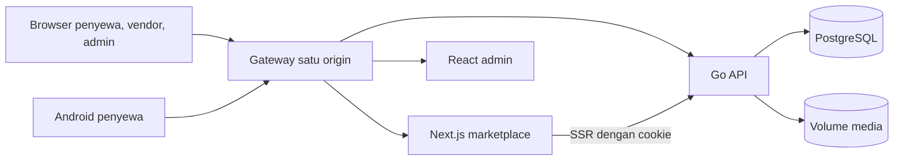

# Arsitektur Rentaid

Gateway Compose melayani `/`, `/admin/`, dan `/api/`. Saat pengembangan, Next.js dan Vite meneruskan `/api` ke Go. API adalah satu-satunya aplikasi yang mengakses PostgreSQL, menjalankan otorisasi, dan menentukan aturan bisnis. Web meneruskan cookie sesi pada SSR; Android menggunakan bearer token melalui API yang sama.

Setiap aplikasi menggunakan pemisahan lapisan sesuai tanggung jawabnya. Struktur folder, alur dependensi, dan batas transaksi dijelaskan pada [lapisan aplikasi](layers.md).

## Kontrak dan data

OpenAPI di `packages/contracts/openapi.json` adalah sumber kontrak `/api/v1`. Validasi request/response dijalankan pada API; tipe TypeScript dan klien Kotlin dihasilkan dari kontrak. Pembaruan API disertai kontrak, klien terdampak, dan test. Migrasi SQL berversi dikelola runner Go/pgx; primary key tabel berupa UUID acak.

Nilai uang disimpan sebagai bilangan bulat rupiah, tanggal sewa sebagai `DATE`, dan waktu kejadian sebagai `timestamptz`. `Clock` Go dan zona Asia/Jakarta menentukan tanggal bisnis dan kedaluwarsa. Database dan volume media harus dicadangkan bersama.

## Transaksi dan stok

Penawaran menghitung harga dan ketersediaan tanpa hold. Checkout mengunci baris produk dan memeriksa pemakaian setiap tanggal dalam transaksi, kemudian menyimpan snapshot dan hold 15 menit. Perubahan stok mengunci baris yang sama. Transisi pesanan mengunci baris pesanan dan memakai compare-and-set; idempotensi checkout/pembayaran menyimpan hasil per pengguna, endpoint, dan key selama 24 jam.

Pembayaran dan refund disimulasikan secara lokal; data dan audit transaksi tetap tersimpan. [Aturan bisnis](../business/rules.md) adalah sumber kanonik status, aktor, dan batas waktu.

## Keamanan dan operasi

Browser menggunakan cookie HttpOnly, CSRF, dan pemeriksaan Origin; Android menyimpan bearer token dengan Keystore. Server menyimpan hash token dan mencabut sesi ketika diperlukan. Upload diverifikasi dari isi dan disimpan pada volume media. Tidak ada CORS longgar atau komunikasi runtime ke layanan pihak ketiga pada demo.

Lihat [keputusan teknis](decisions.md), [panduan engineer](../engineering/README.md), dan [arsip progres MVP](../archive/migration-progress.md).
